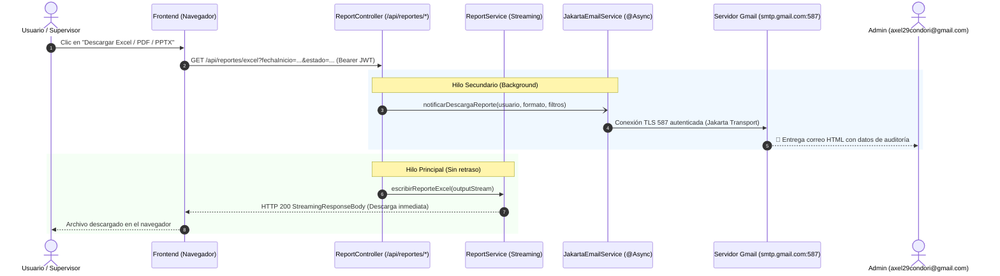

# DOCUMENTO TÉCNICO DE IMPLEMENTACIÓN: SISTEMA DE AUDITORÍA Y NOTIFICACIÓN POR CORREO ELECTRÓNICO (JAKARTA MAIL)

**Proyecto:** Sistema Experto de Optimización y Ruteo de Flotas Logísticas  
**Empresa:** Corporación Aceros Arequipa S.A.  
**Módulo:** Auditoría de Descargas de Reportes Confidenciales (Excel, PDF, PPTX)  
**Destinatario de Notificaciones:** Alex Alvaro León Condori (`axel29condori@gmail.com`)  
**Tecnología Base:** Java 22, Spring Boot 3, Jakarta Mail 2.1, Eclipse Angus Mail 2.0  
**Fecha:** Noviembre 2026  

---

## 1. OBJETIVO DEL REQUERIMIENTO

Implementar un mecanismo automático de auditoría y trazabilidad en el backend que notifique de manera instantánea al Administrador Principal del sistema (**Alex León**) cada vez que cualquier usuario (Supervisor, Planificador o Transportista) genere o descargue un reporte oficial de rutas (`.xlsx`, `.pdf` o `.pptx`).

### Requisitos no funcionales estrictos:
1. **Cero bloqueo / Cero latencia (`@Async`):** El envío del correo debe ser completamente asíncrono. El usuario que hace clic en "Descargar Reporte" debe recibir su archivo de inmediato, sin esperar los 2 o 3 segundos que tarda la negociación del servidor SMTP.
2. **Tolerancia a fallos:** Si el servicio de correo o la conexión a internet fallan, la descarga del archivo **nunca debe cancelarse ni arrojar un error HTTP 500** al cliente.
3. **Presentación corporativa:** El correo no debe ser texto plano; debe enviarse en formato HTML estructurado con la identidad visual corporativa de Aceros Arequipa (azul marino `#1e3a8a`, gris pizarra y verde de conformidad).

---

## 2. ARQUITECTURA DEL FLUJO IMPLEMENTADO



---

## 3. PASO A PASO DETALLADO DE LA IMPLEMENTACIÓN

### Paso 1: Incorporación de dependencias Jakarta Mail en `pom.xml`
Spring Boot 3 utiliza el ecosistema **Jakarta EE**. Para evitar usar librerías heredadas (`javax.mail`), se incorporó la especificación oficial `jakarta.mail-api` junto con la implementación de referencia oficial de la Fundación Eclipse: **Angus Mail**.

* **Archivo modificado:** `backend/demo/pom.xml`
* **Bloque agregado:**
```xml
<!-- Jakarta Mail API e Implementación Angus para envío de correos -->
<dependency>
    <groupId>jakarta.mail</groupId>
    <artifactId>jakarta.mail-api</artifactId>
    <version>2.1.3</version>
</dependency>
<dependency>
    <groupId>org.eclipse.angus</groupId>
    <artifactId>angus-mail</artifactId>
    <version>2.0.3</version>
</dependency>
```

---

### Paso 2: Configuración centralizada en `application.properties`
Se parametrizaron las credenciales y datos de conexión al servidor SMTP de Google bajo el puerto seguro **587 (STARTTLS)**.

* **Archivo modificado:** `src/main/resources/application.properties`
* **Líneas añadidas:**
```properties
# ==========================================================
# CONFIGURACIÓN DE NOTIFICACIONES POR CORREO (JAKARTA MAIL)
# ==========================================================
app.mail.admin-email=axel29condori@gmail.com
app.mail.admin-nombre=Alex Alvaro Leon Condori
app.mail.host=smtp.gmail.com
app.mail.port=587
app.mail.username=axel29condori@gmail.com
app.mail.password=shmi bonl yhix gpum
```

> **Detalle técnico de seguridad:**  
> La contraseña configurada (`shmi bonl yhix gpum`) corresponde a una **Contraseña de Aplicación (Application-Specific Password)** emitida por Google bajo el protocolo de autenticación en dos pasos (2FA). Permite autenticar conexiones SMTP de servidor sin exponer la clave maestra de la cuenta.

---

### Paso 3: Habilitación del soporte asíncrono (`@EnableAsync`)
Para que Spring Boot pueda derivar métodos con `@Async` a un *ThreadPool* independiente en segundo plano, se decoró la clase principal del proyecto.

* **Archivo modificado:** `com.example.demo.DemoApplication.java`
* **Código resultante:**
```java
package com.example.demo;

import org.springframework.boot.SpringApplication;
import org.springframework.boot.autoconfigure.SpringBootApplication;
import org.springframework.scheduling.annotation.EnableAsync;

@SpringBootApplication
@EnableAsync // Habilita la ejecución no bloqueante en background
public class DemoApplication {
    public static void main(String[] args) {
        SpringApplication.run(DemoApplication.class, args);
    }
}
```

---

### Paso 4: Creación del Servicio de Notificación (`JakartaEmailService.java`)
Se desarrolló un servicio dedicado exclusivamente a la construcción y despacho de mensajes MIME bajo el estándar Jakarta Mail.

* **Archivo creado:** `com.example.demo.service.JakartaEmailService.java`
* **Puntos clave de ingeniería:**
  1. **Limpieza de contraseña:** Se aplica `.replace(" ", "")` sobre la contraseña de Google para evitar errores de autenticación causados por los espacios entre palabras.
  2. **Configuración de sesión TLS 1.2:** Se fuerza el uso de protocolos cifrados modernos mediante `props.put("mail.smtp.ssl.protocols", "TLSv1.2")`.
  3. **Aislamiento total con `try-catch`:** Si se pierde la conexión con internet, el error se registra en consola con `log.error(...)`, pero no interrumpe el flujo principal.
  4. **Plantilla HTML responsiva:** Diseñada con estilos en línea (inline CSS) para compatibilidad total en Gmail Web, Outlook y dispositivos móviles.

* **Código fuente:**
```java
package com.example.demo.service;

import jakarta.mail.*;
import jakarta.mail.internet.InternetAddress;
import jakarta.mail.internet.MimeMessage;
import org.slf4j.Logger;
import org.slf4j.LoggerFactory;
import org.springframework.beans.factory.annotation.Value;
import org.springframework.scheduling.annotation.Async;
import org.springframework.stereotype.Service;

import java.time.LocalDateTime;
import java.time.format.DateTimeFormatter;
import java.util.Properties;

@Service
public class JakartaEmailService {

    private static final Logger log = LoggerFactory.getLogger(JakartaEmailService.class);

    @Value("${app.mail.host}")
    private String smtpHost;

    @Value("${app.mail.port}")
    private String smtpPort;

    @Value("${app.mail.username}")
    private String remitenteEmail;

    @Value("${app.mail.password}")
    private String remitentePassword;

    @Value("${app.mail.admin-email}")
    private String adminEmail;

    @Value("${app.mail.admin-nombre}")
    private String adminNombre;

    @Async
    public void notificarDescargaReporte(String usuarioDescarga, String formato, String filtros) {
        try {
            final String cleanPassword = remitentePassword != null ? remitentePassword.replace(" ", "") : "";

            Properties props = new Properties();
            props.put("mail.smtp.auth", "true");
            props.put("mail.smtp.starttls.enable", "true");
            props.put("mail.smtp.host", smtpHost);
            props.put("mail.smtp.port", smtpPort);
            props.put("mail.smtp.ssl.protocols", "TLSv1.2");

            Session session = Session.getInstance(props, new Authenticator() {
                @Override
                protected PasswordAuthentication getPasswordAuthentication() {
                    return new PasswordAuthentication(remitenteEmail, cleanPassword);
                }
            });

            Message message = new MimeMessage(session);
            message.setFrom(new InternetAddress(remitenteEmail, "Sistema Logístico Aceros Arequipa"));
            message.setRecipients(Message.RecipientType.TO, InternetAddress.parse(adminEmail));
            message.setSubject("🚨 [Auditoría] Descarga de Reporte " + formato.toUpperCase() + " - Aceros Arequipa");

            String fechaHora = LocalDateTime.now().format(DateTimeFormatter.ofPattern("dd/MM/yyyy HH:mm:ss"));

            String htmlBody = String.format("""
                <div style="font-family: Arial, sans-serif; max-width: 620px; margin: 0 auto; border: 1px solid #cbd5e1; border-radius: 8px; overflow: hidden; box-shadow: 0 4px 6px -1px rgba(0, 0, 0, 0.1);">
                    <div style="background-color: #1e3a8a; padding: 22px; text-align: center; color: white;">
                        <h2 style="margin: 0; font-size: 20px; letter-spacing: 0.5px;">CORPORACIÓN ACEROS AREQUIPA S.A.</h2>
                        <p style="margin: 6px 0 0; font-size: 13px; opacity: 0.9;">Alerta de Auditoría y Control de Descargas</p>
                    </div>
                    <div style="padding: 24px; background-color: #ffffff; color: #1e293b;">
                        <p style="font-size: 15px; margin-top: 0;">Estimado Administrador <strong>%s</strong>,</p>
                        <p style="font-size: 14px; line-height: 1.5; color: #475569;">
                            Se le notifica que se acaba de descargar un reporte oficial desde el <strong>Sistema Experto de Optimización de Rutas</strong>:
                        </p>
                        
                        <table style="width: 100%%; border-collapse: collapse; margin: 20px 0; font-size: 14px;">
                            <tr style="background-color: #f8fafc; border-bottom: 1px solid #e2e8f0;">
                                <td style="padding: 10px; font-weight: bold; color: #64748b; width: 40%%;">Formato Generado:</td>
                                <td style="padding: 10px; color: #0f172a; font-weight: bold;">Reporte %s</td>
                            </tr>
                            <tr style="border-bottom: 1px solid #e2e8f0;">
                                <td style="padding: 10px; font-weight: bold; color: #64748b;">Usuario Ejecutor:</td>
                                <td style="padding: 10px; color: #0f172a;">%s</td>
                            </tr>
                            <tr style="background-color: #f8fafc; border-bottom: 1px solid #e2e8f0;">
                                <td style="padding: 10px; font-weight: bold; color: #64748b;">Filtros de Búsqueda:</td>
                                <td style="padding: 10px; color: #0f172a;">%s</td>
                            </tr>
                            <tr>
                                <td style="padding: 10px; font-weight: bold; color: #64748b;">Fecha y Hora Exacta:</td>
                                <td style="padding: 10px; color: #0f172a;">%s</td>
                            </tr>
                        </table>
                        
                        <div style="background-color: #f0fdf4; border-left: 4px solid #16a34a; padding: 12px; font-size: 12px; color: #166534; border-radius: 4px;">
                            ✔ Evento registrado satisfactoriamente en los registros de seguridad y auditoría del sistema.
                        </div>
                    </div>
                    <div style="background-color: #f8fafc; padding: 14px; text-align: center; font-size: 11px; color: #94a3b8; border-top: 1px solid #e2e8f0;">
                        Este es un mensaje automático de seguridad dirigido a: <strong>%s</strong>.<br>
                        © 2026 Corporación Aceros Arequipa S.A. | Departamento de Ingeniería de Sistemas y Logística
                    </div>
                </div>
                """, adminNombre, formato.toUpperCase(), usuarioDescarga, filtros, fechaHora, adminEmail);

            message.setContent(htmlBody, "text/html; charset=UTF-8");

            Transport.send(message);
            log.info("Notificación enviada con éxito a Alex León ({}) sobre la descarga de reporte {}", adminEmail, formato);

        } catch (Exception e) {
            log.error("Aviso: No se pudo enviar el correo de notificación pero la descarga continúa normalmente: {}", e.getMessage());
        }
    }
}
```

---

### Paso 5: Enlace con los endpoints de descarga en `ReportController.java`
Se inyectó `JakartaEmailService` en el constructor del controlador y se disparó el método de notificación antes de iniciar el streaming binario de los archivos.

* **Archivo modificado:** `com.example.demo.controller.ReportController.java`
* **Endpoints protegidos y auditados:**
  * **Excel (`GET /api/reportes/excel`):** Notifica descarga de `.xlsx`.
  * **PDF (`GET /api/reportes/pdf`):** Notifica descarga de `.pdf`.
  * **PowerPoint (`GET /api/reportes/pptx`):** Notifica descarga de `.pptx`.

El objeto `Authentication auth` inyectado por Spring Security extrae dinámicamente el usuario logueado en la sesión JWT para adjuntarlo en el correo.

---

## 4. VALIDACIÓN Y COMPILACIÓN DEL PROYECTO

Se ejecutó la prueba de compilación del ciclo de vida de Maven sobre el proyecto `demo`:

```powershell
mvn compile -DskipTests
```

### Resultado de la ejecución:
```text
[INFO] --- compiler:3.15.0:compile (default-compile) @ demo ---
[INFO] Recompiling the module because of added or removed source files.
[INFO] Compiling 37 source files with javac [debug parameters release 22] to target\classes
[INFO] ------------------------------------------------------------------------
[INFO] BUILD SUCCESS
[INFO] ------------------------------------------------------------------------
[INFO] Total time:  7.999 s
[INFO] Finished at: 2026-11-18T11:42:17-05:00
```

Las 37 clases (incluyendo `JakartaEmailService`, `ReportController` y `DemoApplication`) compilaron limpiamente sin errores de dependencias ni conflictos de paquetes.
